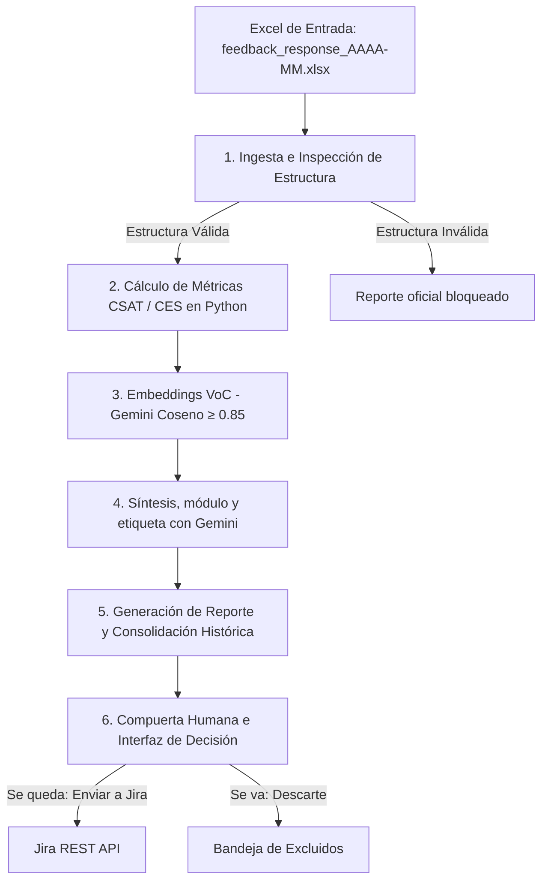

# Orquestador de Métricas UX y Feedback Cualitativo (IA + SDD)

Sistema de orquestación en Python para la ingesta de reportes mensuales de producto (CSAT y CES), cálculo determinista de indicadores y clasificación del Voice of Customer (VoC) mediante embeddings de inteligencia artificial (`gemini-embedding-001`). 

Diseñado bajo la metodología **Spec-Driven Development (SDD)**, priorizando el control presupuestario, la trazabilidad de datos y la gobernanza con compuerta humana (*Human-in-the-Loop*).

La corrida es una vez al mes. La página lee el Excel de ese mes y, en Python, saca CSAT y CES: el dato de cada área, el total del mes y el histórico. Los comentarios de `PREGUNTA ABIERTA` pasan por Gemini. Los embeddings juntan los que dicen lo mismo con otras palabras y el modelo escribe la síntesis, el módulo y la etiqueta. Esa llamada usa la API key de Gemini creada en AI Studio, guardada en `MODEL_API_KEY`.

---

## ⚡ Enlaces Rápidos
* **Demostración Interactiva:** [ximenaflorez.github.io/orquestador](https://ximenaflorez.github.io/orquestador/). Es una copia de solo lectura: subir el Excel, guardar Se queda o Se va y enviar a Jira responden en el servidor local.
* **Documentación del Portafolio:** [Caso de Producto en Portafolio](https://ximenaflorez.github.io/Portafolio2026/trabajos/caso-05-orquestador-reglas/)

---

## 🛡️ Reglas de Negocio y Guardrails

El sistema opera bajo restricciones estrictas de código que el modelo de lenguaje no puede sobrescribir:

1. **Tope Presupuestario Estricto:** Máximo **$3.00 USD por corrida**. Si la ejecución alcanza este límite, el proceso se detiene y deriva los registros restantes a procesamiento manual.
2. **Tiempo de Ejecución:** Para que la corrida quede oficial, el ciclo mensual tiene que terminar en **menos de 3 minutos**.
3. **Determinismo Cuantitativo:** Los promedios de CSAT, CES y el color de las alertas son calculados exclusivamente por código en Python. El modelo de IA no escribe ni manipula cifras.
4. **Umbral de Similitud Coseno ($\ge 0.85$):** Agrupación automática de feedback cualitativo basada en la distancia de vectores. Si la confianza es $<0.70$, el comentario pasa a revisión manual sin etiqueta forzada.
5. **Compuerta Humana (*Human-in-the-Loop*):** Ningún ticket en Jira se crea de forma automatizada. La apertura de historias o tareas requiere aprobación explícita desde la interfaz.
6. **Integridad de Datos:** Si el Excel de entrada presenta inconsistencias o pestañas faltantes, el reporte oficial se bloquea. El archivo fuente queda intacto.

---

## 📐 Arquitectura del Grafo

El flujo de procesamiento sigue un grafo secuencial:



---

## 🚀 Instalación y Uso

### Prerrequisitos
Este proyecto utiliza `uv` como gestor de paquetes y entornos de Python.

```bash
# Clonar el repositorio
git clone https://github.com/Ximenaflorez/orquestador.git
cd orquestador

# Instalar dependencias
uv sync
```

### Abrir la consulta

```bash
uv run orquestador consultar
```

La consulta queda en http://127.0.0.1:8765/.

### Estructura de Archivos de Entrada
Los libros de trabajo deben ubicarse en la carpeta `datos/meses/` manteniendo la nomenclatura estándar:

```plaintext
datos/
└── meses/
    ├── feedback_response_2026-07.xlsx
    ├── feedback_response_2026-08.xlsx
    └── feedback_response_2026-09.xlsx
```

### Ejecutar la Corrida Mensual
Para procesar un mes específico e integrarlo al acumulado e histórico:

```bash
uv run orquestador correr --mes 2026-07
```

También es posible especificar una ruta alternativa de archivo:

```bash
uv run orquestador correr --mes 2026-07 --archivo datos/meses/feedback_response_2026-07.xlsx
```

---

## ⚙️ Configuración de Variables de Entorno (`.env`)

Crea un archivo `.env` en la raíz del proyecto basándote en la siguiente estructura:

| Variable | Descripción / Uso |
| :--- | :--- |
| `MODEL_BASE_URL` | URL base del endpoint del modelo de lenguaje |
| `MODEL_NAME` | Identificador del modelo para procesamiento |
| `MODEL_API_KEY` | Llave de acceso a la API del modelo |
| `MODEL_USD_PER_MILLION` | Costo parametrizado por millón de tokens |
| `MODEL_EMBEDDING_NAME` | Modelo de vectores (ej. `gemini-embedding-001`) |
| `MODEL_EMBEDDING_UMBRAL` | Umbral de corte para similitud de coseno (`0.85`) |
| `JIRA_BASE_URL` | Instancia de Jira (`https://tu-dominio.atlassian.net`) |
| `JIRA_EMAIL` | Correo de la cuenta de integración |
| `JIRA_API_TOKEN` | API Token generado en Atlassian |
| `JIRA_PROJECT` | Clave del proyecto en Jira (ej. `ATS`) |
| `JIRA_ISSUE_TYPE` | Tipo de ticket a crear (por defecto: `Task`) |
| `SMTP_HOST` | Servidor SMTP para notificaciones de error |
| `SMTP_PORT` | Puerto del servidor SMTP |
| `SMTP_FROM` | Remitente de los correos de alerta |
| `SMTP_TO` | Destinatario de los reportes e inconsistencias |

---

## 🧪 Pruebas Unitarias e Integración

Para validar los componentes del motor, el parser de datos y las funciones de cálculo:

```bash
uv run pytest
```

---

## 🔒 Privacidad y Exclusiones del Repositorio (`.gitignore`)

Las claves y los resultados de cada mes se quedan en el computador:
* **`.env`:** Las claves de API y credenciales de Jira/SMTP permanecen estrictamente fuera del control de versiones.
* **`salidas/`:** Los archivos procesados, decisiones tomadas y reportes generados se guardan localmente en la carpeta `salidas/AAAA-MM/` y no se publican en el repositorio.